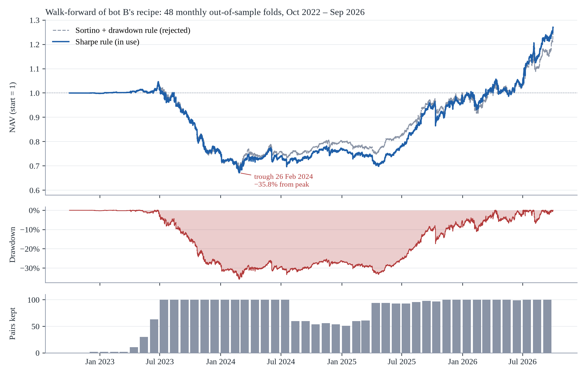
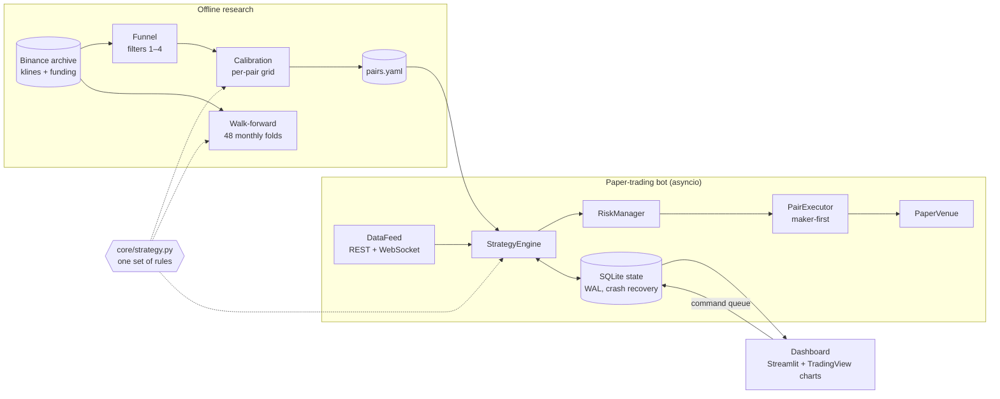

# CryptoPairsBot

### Pairs trading in crypto perpetuals under realistic frictions: a replication, a Kalman-filter extension and a walk-forward evaluation

**Theodoros Rigogiannis** · Athens, Greece · working draft, October 2026

`Python 3.12` · `200+ tests` · `Binance USDⓈ-M perpetuals, hourly bars` · `paper trading only: no live capital`

---

> **Abstract.** We re-implement the pairs-trading framework of Stoikov et al. (2025) on hourly Binance USDⓈ-M perpetual futures and ask how much of its performance survives three steps toward realism: the trading frictions specific to perpetuals, a time-varying hedge ratio, and a rolling, fully out-of-sample evaluation. Under the paper's own assumptions our implementation earns a Sharpe ratio of 2.61 (+48.3%) over March–September 2026, close to the published figures. Bid–ask spread, slippage and funding remove most of this edge. Funding, paid mainly by the short leg, is the largest single cost. A Kalman-filter hedge ratio with maker-first execution lifts the later of two hold-out periods markedly but leaves the earlier one negative. We then re-run the final recipe every month for 48 months (October 2022 – September 2026), over 265 contracts of which 29 have since been delisted. It returns +27.0% in total (6.2% a year), with a Sharpe ratio of 0.54, a Sortino ratio of 0.70 and a maximum drawdown of −35.8%. The mean monthly return is not significantly different from zero (t-test p = 0.31). Returns depend strongly on the regime: −24.6% in 2023, +24.6% in 2025 and +32.4% in the first nine months of 2026. The portfolio is market-neutral on average (daily beta to BTC 0.05) but loses with the market in liquidation cascades. The repository also contains the paper-trading system used to check that live execution matches the backtest.

---

## Contents

1. [Research questions](#1-research-questions)
2. [Data](#2-data)
3. [Method](#3-method)
4. [Evaluation protocol](#4-evaluation-protocol)
5. [Results](#5-results)
6. [Limitations](#6-limitations)
7. [The trading system](#7-the-trading-system)
8. [Reproducing the results](#8-reproducing-the-results)
9. [Repository layout](#9-repository-layout)
10. [Implementation notes](#10-implementation-notes)
11. [Citation and references](#11-citation-and-references)

---

## 1. Research questions

Statistical arbitrage on pairs of related assets is one of the oldest systematic strategies (Gatev, Goetzmann & Rouwenhorst, 2006). Stoikov et al. (2025) adapt it to crypto: a four-stage funnel selects pairs of coins that move together, and an hourly mean-reversion rule trades the spread between them. Crypto perpetual futures differ from the equities of the classic literature in three ways that matter for such a strategy. Positions pay or receive funding every 4–8 hours. Small coins gap by tens of percent within an hour. The universe changes quickly as contracts are listed and delisted. This project studies four questions:

| | Question |
|---|---|
| **RQ1** | Does an independent implementation of the published rules reproduce the published performance on a later, non-overlapping period? |
| **RQ2** | How much of the edge survives realistic frictions (spread, slippage, funding, next-bar fills), and which cost dominates? |
| **RQ3** | Does a Kalman-filter hedge ratio, with maker-first execution, improve on the rolling OLS of the original method? |
| **RQ4** | How does the final recipe perform when it is re-run every month, fully out of sample, across several market regimes and including coins that were later delisted? |

A fifth, practical question runs through the engineering work: **does the live system trade like its backtest?** (§5.6).

## 2. Data

All market data come from Binance's public archive ([data.binance.vision](https://data.binance.vision)) and REST API. The archive includes contracts that have since been delisted.

| Set | Folder | Contents | Used for |
|---|---|---|---|
| Development | `data/` | 197 USDT-margined perpetuals; hourly OHLCV and funding history, June 2023 – September 2026; 1-minute bars where needed | fixed-period experiments (§5.1–5.3), the live bots |
| Walk-forward | `data_wf/` | 265 perpetuals listed by December 2023, 29 of them since delisted; hourly OHLCV and funding from January 2020; 1-minute bars by month | the walk-forward (§5.4) |

A contract listed after December 2023 cannot meet the funnel's 1,000-day history requirement before September 2026, so the walk-forward universe omits no contract that the funnel could have selected. Each coin's blockchain, used by the second filter, comes from CoinGecko. The nine delisted coins that CoinGecko no longer maps were labelled by hand.

## 3. Method

### 3.1 Pair selection funnel

The funnel follows Stoikov et al. (2025, §4.2). Each stage removes pairs:

1. **History.** Both coins have at least 1,000 days of trading.
2. **Structure.** Both coins live on the same blockchain.
3. **Co-movement.** Over the last 800 days, the correlation of log prices is above 0.9 and that of hourly returns above 0.5.
4. **Mean reversion.** The information coefficient between today's Z-score and the spread's forward change, over look-backs of 7 days to 6 months and horizons of 1 hour to 7 days. The 100 pairs with the most negative coefficient (strongest reversion) are kept.

Counts for the selection that bot B trades (data to 30 September 2026):

| Stage | Symbols | Pairs |
|---|---:|---:|
| Universe | 197 | |
| 1. History ≥ 1,000 days | 182 | 16,471 |
| 2. Same blockchain | | 4,505 |
| 3. Correlation filters | | 1,931 |
| 4. Information coefficient | | 1,929 |
| Kept (top 100 by IC) | | **100** |

### 3.2 Spread model

For a pair $(A, B)$ with log prices $y_t = \log P^A_t$ and $x_t = \log P^B_t$, the spread and its Z-score are

```math
s_t = y_t - \alpha_t - \beta_t\, x_t, \qquad Z_t = \frac{s_t}{\sigma_t}.
```

The original method estimates $(\alpha_t, \beta_t)$ by rolling OLS over $L$ hours and takes $\sigma_t$ as the residual standard deviation of the window. Our extension replaces it with a Kalman filter (Kalman, 1960), in which the equilibrium follows a random walk:

```math
y_t = a_t + \beta_t\,(x_t - \bar{x}) + \varepsilon_t,\quad \varepsilon_t \sim \mathcal{N}(0, R_t), \qquad
\begin{pmatrix} a_t \\ \beta_t \end{pmatrix} = \begin{pmatrix} a_{t-1} \\ \beta_{t-1} \end{pmatrix} + \eta_t,\quad \eta_t \sim \mathcal{N}(0,\ \delta R_t I_2).
```

- **No look-ahead.** The Z-score at hour $t$ uses the *prior* $(a_{t\mid t-1}, \beta_{t\mid t-1})$, so a bar never trades on its own update.
- **Memory.** $\delta$ is a signal-to-noise ratio. The equilibrium remembers about $1/\sqrt{\delta}$ hours: $\delta \in \{10^{-7}, 10^{-6}, 10^{-5}\}$ means roughly four months, six weeks or two weeks.
- **Scale.** $\sigma_t = \sqrt{R_t}$ is the root mean square of the prior spread over the previous 720 hours. It measures distance from equilibrium, not dispersion around the window mean, so a persistent one-sided divergence raises $\sigma_t$ instead of collapsing it (§10).
- **Robustness.** An innovation larger than four of its predicted standard deviations does not update the state and enters the $\sigma$ window clipped. After 48 consecutive skips the filter accepts the new level as a regime change. A frozen price (a halted or delisting contract) leaves $\sigma_t$ undefined, so it cannot produce a signal.

### 3.3 Trading rules

Decisions are taken at each hourly close. All thresholds are per pair (§3.5).

- **Entry.** Short the spread (sell $A$, buy $B$) when $Z_t > z_e$; buy it when $Z_t < -z_e$. In the live system $Z$ is computed at executable bid and ask prices.
- **Exit.** A long spread exits when $Z$ crosses up through $-z_x$, a short spread when it crosses down through $+z_x$, with $z_x \in \{0, 0.5\}$.
- **Sizing.** Gross notional is $\lambda E$, where $E$ is the pair's current equity and $\lambda$ the leverage. It splits into $1/(1+\beta)$ on $A$ and $\beta/(1+\beta)$ on $B$. The P&L is then approximately $\lambda E\,\sigma\,\Delta Z/(1+\beta)$.
- **Entry guards.** These are additions to the original method:
  - $0.05 \le \beta \le 20$;
  - $\lvert Z\rvert \le 10$ (a larger value signals a broken relationship or a frozen price);
  - the expected gain $\sigma\lvert Z\rvert/(1+\beta)$ must exceed 1.5 times the round-trip cost.
- **Risk.**
  - Stop-loss when the position loses 20% of the pair's equity at entry, checked at the hourly close, followed by a 120-hour cooldown.
  - Catastrophe stop at 35%, checked on the bar's extremes in the backtest and every 5 seconds live.
  - A pair stops trading once its equity falls to 20% of its initial value.
  - The $\alpha$, $\beta$ and $\sigma$ of an open position stay frozen until exit.
- **Portfolio (live only).**
  - At most 50 open pairs.
  - Gross exposure to any one coin at most 15% of equity in bot B.
  - A kill switch blocks new entries after a 25% drawdown from the peak.
  - Bot B also pauses automatic entries in a pair for 24 hours after either coin moves 15% or more in one hour (since 20 October 2026).

### 3.4 Costs and execution model

| Component | Paper's assumption | Realistic model (this work) |
|---|---|---|
| Taker fee | 5 bps | 5 bps |
| Maker fee | none | 2 bps + 1 bp adverse selection, on one leg |
| Half bid–ask spread | none | 5 bps per leg |
| Slippage | none | 5 bps per leg |
| Funding | none | historical Binance settlements (4 h or 8 h), signed by side |
| Fill price | close of the signal bar | open of the next bar |
| Leverage | 5× | 2× |

**Maker-first execution.**
- A post-only order rests on the larger leg, and every partial fill is hedged at once with a market order on the other leg.
- Whatever is still unfilled after 300 seconds goes to market. Stops always execute at market.
- The paper venue fills a resting order only when the public trade stream prints through its price, or at its price if the order had improved the best quote. This is conservative, because queue position is not modelled.

### 3.5 Calibration

Each selected pair gets its own parameters from a grid search over the preceding 730 days, run with the same costs and rules as above:

- **Kalman:** $\delta$ (3 values) × $z_e \in \{0.8, 1, 1.5, 2, 2.5, 3\}$ × $z_x \in \{0, 0.5\}$, 36 combinations.
- **OLS:** $L \in \{7, 15, 30, 90, 180\}$ days in place of $\delta$.

The rule keeps the combination with the highest annualised Sharpe ratio ($\sqrt{8760}$ scaling) among those with at least five trades.

## 4. Evaluation protocol

### 4.1 Development experiments on two fixed periods

Each variant was calibrated on data that ended before two seven-month periods, **August 2025 – February 2026** and **March – September 2026**. The decision rule was written before every run: the earlier period chooses between variants and the later one only confirms. Many variants were evaluated on the same two periods, so their best numbers are optimistic. For that reason, the headline result is the walk-forward.

### 4.2 Monthly walk-forward

The design follows the protocol of Deep, Deep & Lamptey (2025).

- **Folds.** There are 48 monthly folds, October 2022 – September 2026, and every month is out of sample.
- **Re-selection.** Before each month, the complete recipe runs on data cut at the hour before that month:
  - funnel on 800 days;
  - calibration on 730 days;
  - top 100 pairs by information coefficient.
- **Trading rules.** The month is traded with bot B's rules: entries at hourly closes, exits on 1-minute closes.
- **Month boundaries.** These work as in the live bot:
  - an open position keeps its old parameters until it exits;
  - a pair that drops out of the list can only close;
  - a new pair receives 1/100 of equity.
- **No look-back at results.** No choice is made by looking at walk-forward months.
- **Not simulated:** the kill switch, the 50-position cap, the per-coin cap and the 24-hour shock pause.

### 4.3 Statistical tests

- **Overall result.** Monthly returns are tested against zero with a t-test, a permutation test and a binomial sign test.
- **Selection rules.** The two parameter-selection rules are compared with a paired t-test across months and a month-block bootstrap.

### 4.4 Leakage controls

- **Poison test.** Deleting every bar after June 2024 leaves that fold's funnel and parameter choices unchanged.
- **Exact reproduction.** Run on the fixed periods, the walk-forward engine reproduces the backtests exactly: Sharpe 0.70 and 3.33, 1,160 and 1,235 trades.
- **Unit tests.** They cover the erasure of future data, noise and negative controls, causality of the Kalman prior, and continuity across fold boundaries (`tests/test_walkforward.py`).

## 5. Results

### 5.1 Replication (RQ1)

With the paper's rules and assumptions (profile `strict`: 5×, 5 bps taker fee, fills at the signal close, pairs calibrated on data to 28 February 2026), our implementation earns over **March – September 2026**:

| | Sharpe | Return | Max drawdown | Trades | Stopped out |
|---|---:|---:|---:|---:|---:|
| This implementation, Mar–Sep 2026 | **2.61** | **+48.3%** | −12.1% | 1,114 | 44% |
| Stoikov et al. (2025), their seven-month window | 3.44 | +50.7% | | | |

The pipeline reproduces the published order of magnitude a year later. Two warnings appear already at this stage:

- At 5× leverage, 44% of trades end at the 20% stop. The stop sits inside normal hourly noise.
- With the paper's parameters, the best pair in the paper (BAND–NKN) lost 96% of its capital in this period after a +28% one-hour move on 17 April 2026.

### 5.2 Where the edge goes: frictions (RQ2)

Adding spread, slippage, funding and next-bar fills to the same pairs and parameters cuts the Sharpe ratio on March – September 2026 from 2.61 to 1.18 (+17%) at 5×. Recalibrating every pair under the realistic model at 2× (profile `hardened`, rolling OLS) gives **0.72 (+5.6%)**. Over that period, funding cost 5.4% of capital, almost three times the fees (1.9%).

On the earlier period the same configuration loses money. The table adds one cost at a time:

| August 2025 – February 2026, rolling OLS, 2× | Return |
|---|---:|
| No costs | −0.4% |
| + fees | −2.1% |
| + spread and slippage | −4.8% |
| + funding | **−8.7%** |

- **Funding** is the largest single cost. It falls mainly on the short leg, because the coins the strategy sells after a rally tend to carry negative funding (shorts pay longs).
- **Liquidation crashes.** The cascade of 10–11 October 2025 alone cost about 17% of capital in this period.
- **Payoff asymmetry.** The win rate is 65%, but the average loss is 2.2 times the average gain.

### 5.3 Model and execution (RQ3)

Each row adds one change to the row above. The first three rows are recalibrated; the last two reuse the third row's pairs and parameters and change only the rule. Figures are Sharpe ratio / total return:

| Variant | Aug 2025 – Feb 2026 | Mar – Sep 2026 |
|---|---:|---:|
| Realistic frictions, 2×, rolling OLS (`hardened`) | −0.56 / −8.7% | 0.72 / +5.6% |
| + Kalman-filter hedge ratio (K1) | −0.51 / −9.7% | 2.85 / +27.5% |
| + maker-first on one leg, \|Z\| ≤ 10 entry guard (live profile `kalman`) | −0.30 / −6.5% | 3.56 / +36.6% |
| + exits checked on 1-minute closes (bot B's rule) | 0.70 / +5.6% | 3.33 / +32.9% |
| + 24 h pause after a ≥ 15% one-hour move (bot B since 20 Oct 2026) | 0.89 / +6.8% | 3.47 / +32.4% |

- **Kalman filter.** It transforms the later period and leaves the earlier one about where it was.
- **Calibration.** In-sample Sharpe barely predicts which pair will do well out of sample: the correlation across pairs is 0.05 and 0.09 in the two periods. Yet per-pair thresholds still beat common ones in both periods (§5.7). The calibration ranks pairs poorly but sets threshold levels usefully.

### 5.4 Walk-forward, October 2022 – September 2026 (RQ4)



*Figure 1. NAV of the walk-forward under the two parameter-selection rules, the drawdown of the rule in use, and the number of pairs selected before each month. The early folds have few pairs because of the 1,000-day history filter; the book is full from July 2023. Data: `runs/walkforward_b/`; figure: `docs/figures/make_figures.py`.*

| Selection rule | Sortino | Sharpe | Max DD | Total | Per year | Worst day | Trades | Win rate | Positive months | p (t-test) |
|---|---:|---:|---:|---:|---:|---:|---:|---:|---:|---:|
| **Sharpe** (in use) | **0.70** | 0.54 | −35.8% | +27.0% | 6.2% | −8.2% | 6,816 | 78.4% | 24 / 48 | 0.31 |
| Sortino + drawdown | 0.69 | 0.53 | −34.5% | +24.4% | 5.6% | −6.4% | 5,072 | 75.7% | 23 / 48 | 0.33 |

| Year (Sharpe rule) | Months | Return | Max drawdown | Sortino |
|---|---:|---:|---:|---:|
| 2022 | 3 | −0.2% | −0.3% | −3.78 |
| 2023 | 12 | **−24.6%** | −28.3% | −3.33 |
| 2024 | 12 | +2.3% | −10.7% | 0.31 |
| 2025 | 12 | +24.6% | −10.3% | 2.13 |
| 2026 | 9 | **+32.4%** | −7.4% | 3.48 |

- **No significant edge over four years.** The mean month is +0.57% (95% CI −0.50% to +1.67%; permutation p = 0.31). Only half the months are positive.
- **Regime dependence.**
  - The NAV fell 35.8% from its peak on 26 June 2023 to its trough on 26 February 2024. It regained the peak only on 8 April 2026.
  - In 2023, 315 stop-loss exits lost 659k (from 1M of initial capital), more than the 484k earned by 647 signal exits. From 2025 onward, signal exits outweigh stops.
  - The live kill switch (−25% from peak), which this simulation does not model, would have halted new entries on 9 November 2023.
- **The fixed periods were a favourable regime.** The strong figures of §5.3 come from 2025–26 and do not describe the strategy's long-run behaviour.
- **Selection rule.** The rule written before the run would adopt Sortino + drawdown only if both its Sortino and its drawdown were better. Only the drawdown is, so the Sharpe rule stays. Month by month, the two rules are indistinguishable (paired p = 0.78).

### 5.5 Market exposure

Daily walk-forward returns regress on BTC with a beta of **0.05** (correlation 0.19, R² 3.7%). Against an equal-weighted index of all coins in the universe, the beta is 0.03 (R² 3.2%). The book is therefore market-neutral on average.

It is not neutral in crashes. On the ten worst days for altcoins (mean −15.3%), it lost 1.5% on average. Its worst day was the liquidation cascade of 10 October 2025, when altcoins fell 22% and BTC 7%. Nor is it neutral to single coins: in the live list, OGN appears in 18 pairs and BAND in 13.

### 5.6 Does the live system trade like its backtest?

Two paper-trading deployments run on a VPS in Docker, with real-time Binance data and €100 of virtual capital per pair:

- **A** (profile `kalman`): since 1 October 2026.
- **B** (profile `kalman_b`): since 5 October 2026, with 93 pairs on 47 coins.

**Fidelity check.** For 5 – 12 October 2026, replaying the same days in the backtester with B's pairs and parameters loses €652. B lost €509 in paper trading over those days, and the per-pair results correlate at 0.83. One week is far too short to judge performance, but the execution layer behaves as modelled.

**Stops realise beyond their thresholds.** In paper trading, the 20% stop (checked hourly) closed at −25.7% on average and the 35% catastrophe stop (checked every 5 s) at −36.6%. Prices gap between checks.

### 5.7 Negative results

Every idea below was tested against a rule written before the run. All except the shock pause in §5.3 were rejected.

| Idea | Evidence | Verdict |
|---|---|---|
| Short only coins with positive funding | Sharpe 0.72 → 0.21 (Mar–Sep 2026): funding turns into income, but the profitable trades disappear | rejected |
| Spot instead of perpetual for the long leg | 0.72 → 0.69 | rejected |
| Time stop (3 half-lives), Z-stop, smoothed parameters | every variant below the baseline on Aug 2025 – Feb 2026; two looked better on Mar – Sep 2026 only | rejected |
| Common thresholds (2.0 / 0) for all pairs | −0.42 / 3.09 against −0.30 / 3.56 per pair | rejected |
| Adaptive threshold (95th percentile of \|Z\| over 30 days) | −0.68 / 2.66: worse in both periods | rejected |
| Kalman on the last year only (deployment A) | −0.52 / 2.78 against −0.30 / 3.56 with full history | B uses full history |
| 24 h quarantine of a coin after a stop | 3.56 → 2.80 on Mar–Sep 2026: removes mostly winning trades | rejected |
| Stop at \|Z\| ≥ 4 | halves the average loss, but costs 45% of the profit on Mar–Sep 2026 | rejected |
| Shock pause checked every minute instead of hourly | 0.38 / 3.95 against 0.89 / 3.47: better in one period, worse in the other | rejected |
| Sortino + drawdown parameter selection | walk-forward Sortino 0.69 vs 0.70 | rejected (§5.4) |
| At most two legs per coin | portfolio P&L halves (3,102 → 1,503), Sharpe 3.88 → 3.08: the same as cutting leverage | rejected |
| Skip entries after a > 6σ jump of one leg | in sample, post-jump entries earn more (+10.4% vs +5.8%) | rejected: over-reaction is part of the edge |

## 6. Limitations

- **Statistical power.** Four years of monthly folds cannot distinguish the walk-forward's 6% a year from zero. A deflated Sharpe ratio (Bailey & López de Prado, 2014) that accounts for every variant tried in §5.3 and §5.7 has not been computed yet.
- **Regime dependence.** The strategy lost a quarter of its capital in 2023 and needed almost three years to recover its peak.
- **Payoff asymmetry and concentration.**
  - The average loss is about twice the average gain (2.2× on August 2025 – February 2026), so the strategy needs a win rate near 69% just to break even.
  - Pairs that share a coin stop out together when that coin rallies.
- **Simulation scope.**
  - The walk-forward omits the live risk overlays (§4.2).
  - Maker fills are simulated without queue position.
  - No order has reached an exchange: the live venue is not yet implemented.
- **Pair freshness.** The deployed bots never re-select pairs. B's list uses all data up to 30 September 2026, so only its paper-trading period is truly unseen for those pairs.

## 7. The trading system

The same strategy core (`cryptopairs/core/strategy.py`) makes every decision in the backtest, the walk-forward and the paper bot. A parity test checks the new backtester bar by bar against the reference code of Stoikov et al. (2025) when that code is present locally; it is not redistributed here.



- **Market data.**
  - Candles come over REST with gap filling; books and trades over WebSocket (ccxt.pro).
  - A REST snapshot every 20 s covers quiet books. Quotes older than 45 s block new entries.
- **Execution.**
  - Decisions are taken under a lock; the two legs then execute concurrently.
  - Maker-first orders run in the background and are cancelled on shutdown.
  - Real Binance funding is settled on paper positions.
- **State.**
  - SQLite in WAL mode, with write-ahead pending orders and atomic fill commits.
  - Positions are restored after a restart. Orphaned pairs can only close.
  - Parameter changes wait until a position is flat.
- **Monitoring.**
  - A multi-page dashboard (portfolio NAV and drawdown, pair desk with live order books, trade journal, backtest lab) reads the database in read-only mode.
  - Its buttons only queue commands (pause, close, flatten, manual orders), which the bot executes and rejects after 120 s.
  - Telegram alerts report price shocks, clusters of stops and a bot that stopped.
- **Operations.**
  - Docker Compose runs one service per bot plus the dashboard.
  - More than 200 unit and integration tests cover persistence and crash recovery, execution, the strategy rules and the walk-forward's causality.

## 8. Reproducing the results

```bash
python3.12 -m venv .venv && source .venv/bin/activate
pip install -r requirements.txt -r requirements-dashboard.txt
python -m pytest -q                                              # 200+ tests, ~30 s

# data
python -m cryptopairs download                                   # Binance archive, incl. delisted contracts
python -m cryptopairs metadata                                   # blockchains from CoinGecko (filter 2)

# §5.1–5.3: fixed periods
python -m cryptopairs research --tag latest                      # the paper's rules (profile strict)
python -m cryptopairs --profile hardened research --tag hardened # realistic frictions, OLS
python -m cryptopairs --profile kalman experiments --only K1 C1 W1 --out runs/experiments_ab

# §5.4: walk-forward of bot B's recipe
python -m cryptopairs --profile kalman_b walkforward data        # data_wf/ from January 2020
python -m cryptopairs --profile kalman_b walkforward run         # select, simulate, report
python -m cryptopairs --profile kalman_b walkforward poison --month 2024-06
python docs/figures/make_figures.py                              # Figure 1

# the live configuration
python -m cryptopairs --profile kalman_b research --final --tag kalman_b --top 100
python -m cryptopairs --profile kalman_b paper --name kalman_b   # paper trading, no API keys needed
python -m cryptopairs dashboard                                  # http://localhost:8501
```

All settings live in `config/config.yaml`; a profile (`strict`, `hardened`, `kalman`, `kalman_ts`, `kalman_b`) overlays the base values. Raw data and run outputs are not tracked, except each run's `pairs.yaml`. The walk-forward's chain map (`data_wf/meta/chains.csv`) was assembled once and is not tracked.

## 9. Repository layout

```
cryptopairs/
  core/        strategy rules, Kalman filter and OLS, sizing, pair accounting (no I/O)
  research/    data download, funnel, calibration, backtest, experiments, walk-forward
  runtime/     feed, engine, risk, execution, SQLite store, commands, alerts
  ui/          dashboard pages, charts and data access
  cli.py       python -m cryptopairs <command>
config/        config.yaml with all profiles
tests/         200+ tests
docs/          figures and technical notes
runs/          research outputs (only pairs.yaml files are tracked)
Dockerfile, docker-compose.yml, deploy.sh
```

## 10. Implementation notes

**Where the paper is ambiguous.**
- **Refitting.** Algorithm 1 refits at every bar, even in a position, while the live controller refits only when flat. We refit at every bar while flat and freeze the fit in a position.
- **Deactivation.** Algorithm 1 deactivates a pair when its equity falls below 20% of the initial value, while §5.3 speaks of a drawdown above 20%. With a 20% stop-loss, the second reading would deactivate a pair at its first stop, far more often than the paper reports, so we use the equity floor.
- **Filters.** As in the paper's final version, there is no cointegration test and no half-life rule.

**Differences from the reference code.**
- The hedge uses the signed $\beta$, restricted to $[0.05, 20]$, rather than $\lvert\beta\rvert$.
- Cointegration is not required.
- Orders fill at the next bar's open with costs and funding, not at the signal bar's close.

**A bug that paper trading caught.** An early version computed $\sigma$ as a standard deviation around the window mean. When a spread diverged persistently to one side, $\sigma$ collapsed and $Z$ exploded: one live pair showed $Z = 37$. The backtest had hidden this. $\sigma$ is now the root-mean-square distance from equilibrium, entries require $\lvert Z\rvert \le 10$, and a regression test guards the fix.

## 11. Citation and references

If you use this code or its results, please cite:

```bibtex
@software{rigogiannis2026cryptopairs,
  author  = {Rigogiannis, Theodoros},
  title   = {CryptoPairsBot: Pairs Trading in Crypto Perpetuals under Realistic Frictions},
  year    = {2026},
  version = {0.2.0},
  url     = {https://github.com/Rigojohn/Pairs-Trading-Mean-Reversion}
}
```

- Bailey, D. H., & López de Prado, M. (2014). The deflated Sharpe ratio: correcting for selection bias, backtest overfitting, and non-normality. *Journal of Portfolio Management*, 40(5), 94–107.
- Deep, G., Deep, A., & Lamptey, W. (2025). Interpretable hypothesis-driven trading: a rigorous walk-forward validation framework for market microstructure signals. arXiv:2512.12924.
- Gatev, E., Goetzmann, W. N., & Rouwenhorst, K. G. (2006). Pairs trading: performance of a relative-value arbitrage rule. *Review of Financial Studies*, 19(3), 797–827.
- Kalman, R. E. (1960). A new approach to linear filtering and prediction problems. *Journal of Basic Engineering*, 82(1), 35–45.
- Stoikov, S., Xu, D., Shao, S., Wang, Y., Zhang, T., & Hu, J. (2025). *Pairs Trading in Crypto*. Cornell Financial Engineering Manhattan. SSRN 6188418. Reference code: [github.com/Jim-Shao/CryptoPairTrading](https://github.com/Jim-Shao/CryptoPairTrading).

---

*This is research code. Nothing here is investment advice, and no strategy in this repository has traded real money.*
